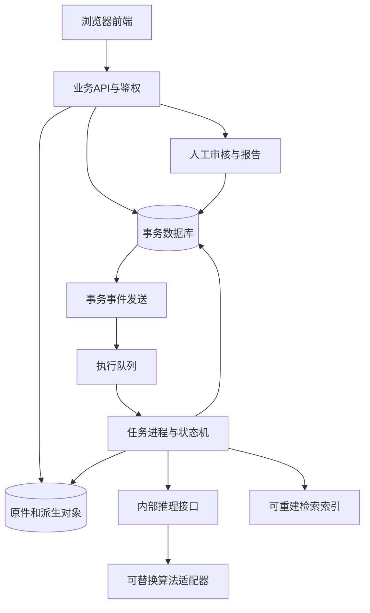

# 系统架构与服务边界

版本：0.1；整理日期：2026-10-12；状态：规划草案，NOT_FROZEN。

依据：DES-001 §4、§5、§8及TASK-001；本文件将设计转为代码组织建议，不改变业务范围和正式状态。

| 层次 | 职责 | 计划实现位置 |
| --- | --- | --- |
| 业务应用 | 上传、任务、证据展示、审核、报告 | frontend |
| 能力服务 | 授权、接入、资产、编排、检索、审核和审计 | backend |
| 智能算法 | 媒体处理、模型适配、推理、同源验证 | ai-services与backend任务进程 |
| 数据资源 | 事务、对象、检索索引、传播关系 | 后端存储适配器及deploy配置 |
| 基础设施 | Linux、容器、队列、监控与恢复 | deploy、config、scripts |

初期建议一个模块化后端、独立任务进程和可独立部署的算法服务。模块划分不等于必须部署12个微服务。前端只经业务API访问数据；内部算法调用不向浏览器暴露模型凭据。算法输出经后端登记证据和结果，不直接更新正式审核结论。

上传会话、媒体资产、分析任务分别使用upload_id、asset_id、task_id。校验通过的资产才可创建分析任务。长任务异步返回状态；结果记录输入摘要、模型/预处理/映射版本及证据引用。正式结论按适用审核流程形成。

采用快速筛查、深度核查、取证溯源三级处理；无对应模态时显式跳过。语义向量只召回候选，图片几何验证和视频时序对齐支撑同源判断；首发是观察范围内候选。具体状态、错误和字段引用现有[工作流](../05-workflows/README.md)与[API契约](../03-api/README.md)，不在此再造字段。

## 本轮已实现的工程链路

CPU研发最小工程已实现图中浏览器→API→对象/数据库→outbox→RabbitMQ→worker→独立推理→结果保存。索引、正式人工审核/报告、身份与案件授权仍属正式业务规划。具体PoC边界见[技术基线](technical-baseline.md)与[PoC API](../03-api/poc-api.md)；不把本轮实现替换总体业务架构。
