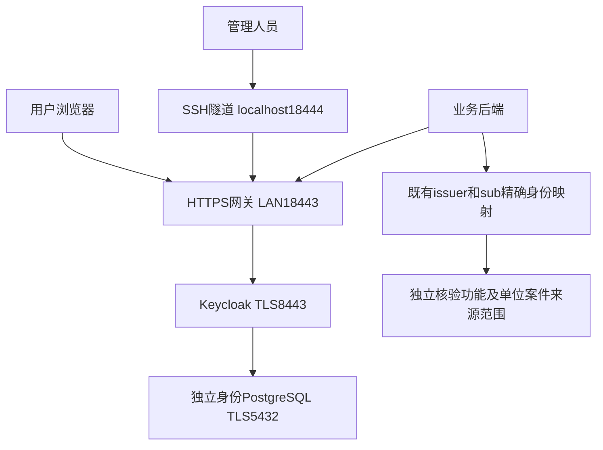

# T013 项目自建 Keycloak 身份系统完整设计

日期：2026-10-17。状态：**方案及8步实施计划已获用户认可；身份服务已在Linux隔离项目部署并完成多项研发验证**。步骤状态与边界见[实际执行报告](../00-project/validation/t013-keycloak-execution-report.json)及[8步计划](t013-keycloak-implementation-plan.md)。软件正式准入、实名管理员/用户交接、异地灾备和T013整卡验收仍未完成。

本设计用于建立可实际验证的项目身份服务，补足 T013 登录、令牌签发和会话失效的接入条件。用户确认目前没有现成正式身份系统，要求采用 Keycloak 并部署到现有 Linux 服务器。本系统是项目自建身份源；公安统一身份平台接入、正式软件准入及生产验收仍需各自的实际依据。

## 1. 依据、现状与修改边界

工程规则为[根 AGENTS](../../AGENTS.md)，任务来源为[T013 实现认证与令牌校验](../../tasks/platform/T013.md)，依赖为[T012](../../tasks/platform/T012.md)。公共业务结构继续以[OpenAPI](../03-api/openapi.yaml)为源，权限使用[权限矩阵](../08-security/permission-matrix.md)和已有数据库迁移，不用身份令牌中的角色替代案件权限。

已存在的[首批适配器](t013-token-validation.md)支持可选 RFC7662 远端核验及精确数据库身份映射；当前默认不安装正式身份提供方。其合成 HTTP 测试和隔离数据库测试不证明真实 Keycloak 已接入。本设计不更改原100包运行锁、Python3.10研发环境、原7服务、PoC登录方式或170任务范围。

设计编制批次仅交付设计、导航和审查记录；后续已形成8步实施计划。待实施范围包括独立身份部署、私密配置、现有适配器的 CA 信任及显式装配、真实认证与恢复测试。主业务前端改造、全业务权限实现、正式机构 SSO、异地高可用不纳入本子系统交付；不得据此把 T013 或全项目标为完成。

## 2. 选型与制品控制

采用 Keycloak，避免自行实现密码存储、OIDC签发和会话协议。自研认证的密码学与运维维护负担较大；仅保留模拟身份无法实现用户要求的真实登录。Keycloak使用独立 PostgreSQL 和 HTTPS 网关，不将身份表放入 PoC 或业务数据库。

| 项目 | 本设计决定 | 实施前必须形成的证据 |
| --- | --- | --- |
| 身份服务 | Keycloak26.8.1候选，生产启动模式，优化镜像 | 官方来源、精确镜像摘要、软件物料及漏洞/许可核查；禁止latest/start-dev |
| 数据库 | 独立PostgreSQL16系列，与现有工程大版本一致 | 实施时选择受支持补丁并锁定摘要；不是复用现有PG卷 |
| 网关 | Nginx稳定发行候选 | 精确版本、摘要、TLS能力和漏洞/许可核查后才可构建 |
| 协议 | OIDC授权码+PKCE S256；API逐请求RFC7662核验 | 真实服务协议测试与撤销时限实测 |
| 运行环境 | 当前Linux x86_64，Docker desktop-linux | 重查引擎、空间、端口、网络和私密卷权限 |

Keycloak当前官方下载页列出26.8.1，版本会变化；本设计没有虚构镜像摘要，也没有把“候选”写成已锁定制品。[官方版本](https://www.keycloak.org/downloads)、[生产运行要求](https://www.keycloak.org/server/configuration-production)、[数据库支持](https://www.keycloak.org/server/db)、[容器构建](https://www.keycloak.org/server/containers)。

## 3. 部署结构与资源

独立Compose项目名 `media-trace-identity`，仅三个常驻服务：`identity-gateway`、`keycloak`、`identity-postgres`。数据库仅接身份后端网络；Keycloak只接受网关的应用流量。独立数据库、账号、网络及具名卷均使用该项目前缀。Keycloak8443、健康检查9000、数据库5432不发布宿主端口。

初始资源上限提案：Keycloak1.5CPU/3GiB、PG1CPU/2GiB、网关0.5CPU/1GiB，合计3CPU/6GiB；分别设置进程及日志限制，按实测调整。该配额不是已分配资源，也不能证明20/100并发。数据库预留20GiB规划容量，部署时同时要求相关文件系统可用空间大于既有5GiB保护值，并能容纳制品、数据库增长和一份完整恢复副本；达不到则停止部署，不删除其他项目卷。

现有历史记录已区分Linux宿主 `/workspace` 与Docker虚拟机数据卷，不能将宿主空闲空间当作虚拟机可用空间。Docker Desktop虚拟机与宿主也不保证同路径可挂载：私密文件通过受控传输写入身份专用具名卷，验证卷内容、属主和权限，不假定宿主绝对路径可直接绑定。

## 4. 地址、网关和管理隔离

| 用途 | 固定设计值 |
| --- | --- |
| 用户基础URL | `https://172.16.58.179:18443` |
| 项目realm | `media-trace` |
| 唯一issuer | `https://172.16.58.179:18443/realms/media-trace` |
| 管理URL | `https://localhost:18444`，宿主仅绑定127.0.0.1，经SSH转发访问 |
| Discovery | issuer加 `/.well-known/openid-configuration` |
| 协议端点 | issuer加 `/protocol/openid-connect/` 下的 `auth`、`token`、`certs`、`token/introspect`、`revoke`、`logout` |

以上是待部署配置，不是现已可用地址。18443在局域网可访问，不代表开放到互联网。18444冲突时停止，不自动更换issuer或扩大监听范围；本地SSH端口与管理URL一致，避免任意转发端口造成回调不匹配。

固定hostname及hostname-admin，关闭动态后端URL。公开监听只允许所需realm协议、登录页面、静态资源和Account Console；明确拒绝 `/admin` 及其子路径、管理健康/指标端点。校验重复斜杠、编码路径、大小写和路径规范化绕过。管理监听允许管理UI和REST接口。仅设置hostname-admin不足以阻止公共管理API，必须由网关落实。[官方hostname说明](https://www.keycloak.org/server/hostname)。

管理登录可能使用公开hostname上的master realm协议回调；允许所需认证端点不等于允许公开admin API。实施必须验证完整管理登录重定向链、CSP/CORS及两入口边界，不可简单封禁全部master协议后宣称管理登录可用。

网关拒绝未知Host，覆盖而非追加外部Forwarded/X-Forwarded头；仅网关可访问Keycloak，固定转发协议及端口。网关到Keycloak再次使用TLS并校验证书，数据库连接使用verify-full。管理9000端口只用于内部健康检查，不透传。[官方反向代理要求](https://www.keycloak.org/server/reverseproxy)。

## 5. 证书、密钥与时间

项目私有CA签发入口、Keycloak内部服务和数据库服务证书，SAN分别覆盖实际使用的IP、localhost和容器DNS名；不使用CN代替SAN。CA私钥保存在Linux私密运行目录并另行加密备份，不挂载到应用；每个服务只读取自身私钥和必要的公有信任链。

客户端必须信任项目CA。提供公有CA证书及摘要和明确导入说明；验证浏览器及Python实际信任，不自动修改用户全系统证书库。既有适配器仍依赖默认信任库，后续需要增加显式SSLContext/CA路径装配及测试；本轮没有完成该能力。禁止verify=False、忽略证书错误或降级HTTP。

证书建议90天有效、提前30天告警，此为平台参数提案；备份CA和轮换服务证书时重新验证各连接。容器和宿主使用可靠时间源，监测偏差；检测明显时钟异常时停止正式接入。令牌到期不因网络重试延长。

issuer是身份映射键的一部分。未来域名/IP变更需独立迁移方案和回归，不能直接改URL后用邮箱重新绑定账户。

## 6. 用户、客户端及业务数据权责

Keycloak管理认证凭据、登录会话和MFA；既有业务数据库管理内部用户、单位、角色、案件关系和来源授权。认证成功后，以 **issuer+sub** 精确查询已授权映射；不按姓名、邮箱或用户名自动认领内部用户，不自动生成单位、案件或超级用户。未映射、禁用、撤销映射或无案件/来源策略均不能获得业务权限。

Keycloak管理员不自动成为业务管理员；令牌角色、组、scope均不能直接绕过业务授权。业务数据库连接延续最小权限身份查询，拒绝超级用户/BYPASSRLS及目录管理角色。已有T012模型与迁移复用；若实现发现必须更改公共契约或数据库结构，另行说明并走版本迁移，不能临时直改生产表。

| 客户端或账户 | 配置与用途 | 禁止行为 |
| --- | --- | --- |
| `media-trace-api` | 机密客户端；后端持有独立轮换secret调用introspection | 密钥进入浏览器、启用不需要的服务账号业务权限 |
| 业务Web客户端 | 未来按真实HTTPS前端地址登记精确redirect URI，PKCE S256 | 当前PoC直接升级、通配回调、密码grant、隐式流 |
| 隔离验收realm/client/user | 仅自建无敏感夹具，临时精确回调入口 | 验收账号进入正式业务realm或证明真实人员授权 |
| 临时技术管理员 | 随机凭据仅私密交付；建立实名管理员并验证MFA后移除bootstrap | 默认公开密码、凭姓名自动创建真实人员账户 |

初始可用登录界面采用Keycloak Account Console。业务前端完整接入仍需对应前端任务实施，当前不新增公共API回调契约。真实授权码测试可使用SSH管理通道下的临时回调工具，仅测试期间启用，严格state、nonce、PKCE及精确redirect URI；该工具不是第四个常驻正式服务。

关闭自助注册、密码直接授权和隐式流；邮件SMTP尚未提供，禁用邮件自助重置并提供经核实的管理员恢复流程。邓昀仅已有T001—T011负责人登记，本设计不自动将其扩展为T013负责人或身份管理员。

授权码为推荐浏览器流程，introspection仅由机密客户端使用；不以用户密码调用token端点充当真实浏览器登录验收。[官方OIDC协议说明](https://www.keycloak.org/securing-apps/oidc-layers)。

## 7. 令牌、会话及失效设计

以下为可审阅的平台初始参数，尚非现网生效值，也不是公安业务制度：访问令牌300秒，SSO空闲1800秒、最长28800秒；关闭remember-me及offline_access，刷新令牌轮换且重复使用次数0。管理员强制MFA；密码最短14字符，使用Keycloak提供的密码散列与暴力破解保护，不自研密码学。普通用户MFA适用范围由上线身份管理决定，未完成该决定不进行真实用户正式交付。

API逐次在线introspection，无有效结果缓存；随后重新查业务身份状态。校验active严格为true、预期issuer/audience、sub、Bearer类型及有效时间，拒绝畸形、超长和重复字段；不把“能解析JWT”当验证签名。通过Keycloak实际验证签名并返回active，与后端字段校验共同形成信任链；JWKS保留用于密钥轮换观察及协议一致性验证，不建立未经验证的本地旁路。

为访问令牌配置明确API audience，禁止用ID token调用业务API；真实服务测试若无法稳定区分则阻止接入并修正配置/适配器，不放宽现有断言。客户端secret轮换需先使旧secret失效，再确认新secret成功和旧secret失败。

提出低负载验收目标：管理员禁用用户、撤销会话、显式退出或撤销refresh token后，最迟10秒内新业务请求被拒绝；实际是否满足需逐项实测，不能假定Keycloak对所有撤销动作行为相同。若只撤销refresh token而旧access token仍active，则必须采用明确的会话终止/有效时间策略，不能将其当作通过。已开始业务事务的取消另属任务编排范围。

网络核验建议单次超时2秒，数据库连接/语句需有有限超时，具体实现需验证总耗时并写入配置。不可用、TLS失败、响应不可信均拒绝动作，不降级到模拟身份、旧缓存或匿名权限。缺少身份提供方仍按现有503边界；无效身份沿用既有401，权限不足沿用既有契约，不新增不一致错误码。

## 8. 配置、审计与运维目录

代码来源目录维持 `/workspace/glwy/projects/media-traceability-system`。私密运行根目录为 `/workspace/glwy/runtime/media-traceability-system/identity/`，建议目录权限0700、私密文件0600；容器内按运行UID授予只读最小权限，不机械套用宿主UID。不得将secret写入Compose、环境打印、Git、CI制品或shell历史。

仓库拟新增 `deploy/identity/` 放部署模板和网关配置，非秘密版本参数放配置文件；上述是后续计划位置，本轮尚未创建部署代码。私密配置加载须校验路径、权限、证书链、issuer和audience完整性后才显式安装身份提供方；缺一拒绝启用，不能在create_app中偷偷启用默认模拟配置。

身份管理员、数据库维护、备份恢复分角色操作；Docker引擎管理员仍可读容器和卷，不能宣称容器secret对其不可见。没有额外人员时记录职责集中风险，不编造已实现双人审批。

启用登录成功/失败、账户禁用、客户端/权限及密钥管理事件。日志只记必要事件类型、受控关联ID、结果和脱敏主体；禁止口令、token、auth code、secret、完整请求正文和URL查询串。网关访问日志仅记路径而非含参数URL，临时回调关闭敏感访问日志。初始容器日志10MiB×3轮转，事件保留7天为研发提案；正式保留期限未确认，不能用该值覆盖项目制度。

健康检查分应用存活、就绪及数据库可用；身份失效不影响原PoC健康，也不能由PoC健康推断正式认证可用。启停仅操作独立身份Compose项目，回滚不触碰其他项目卷。

## 9. 备份、恢复与回滚

数据库使用同大版本pg_dump，通过受控管道加密保存；备份包含realm、客户端、用户凭据和签名密钥等数据库状态，CA私钥另行加密备份。接收方公钥可以分发，解密私钥不存同一在线备份目录。GPG完整性校验并结合受控签名/校验记录，不能只用可被同时替换的SHA文件证明真实性。

备份落在Linux宿主的私密目录，离开Docker虚拟机数据卷；写入前验证实际目标，不因路径同名误写回原卷。独立异地主机未提供，因此这不是异地灾备。研发建议每日备份、保留7份，并在配置/升级前另做备份；RPO/RTO正式值仍未批准，必须报告实测恢复时间和备份时间点。

恢复使用新建具名卷、隔离网络和临时端口，验证备份解密、数据库一致性、realm/客户端/签名密钥及业务映射关系；不得覆盖现有数据库。恢复演练不能直接抢占现网issuer入口。备份可能恢复旧会话/撤销状态，正式切换前清除恢复会话、提升realm有效时间并轮换必要客户端secret，验证备份前token和secret均不能重新取得权限；未验证不得切换。

升级前保存旧镜像摘要及加密数据库备份；数据库发生不兼容升级时恢复到新卷配旧版本，不能让旧版本直接打开已升级库。撤回身份接入时显式卸载正式provider并恢复默认拒绝，不改为放行；保留私密审计和备份，不默认删除卷。

## 10. 实施失败处理

| 条件 | 必须采取的动作 |
| --- | --- |
| 端口、容量、证书、制品摘要检查失败 | 停止受影响部署，保留原7服务和现有数据 |
| 公网管理API可达或代理头可篡改 | 禁止交付身份入口，修复隔离后重测 |
| 无真实人员/映射授权 | 仅隔离技术验收，不签发可用业务权限 |
| 撤销、禁用或过期测试失败 | 禁止正式provider启用，不修改断言或延长窗口掩盖问题 |
| 备份不可解密或恢复失败 | 标记恢复未通过，不称可恢复正式环境 |
| 需要变更公共接口或源任务范围 | 记录冲突，停止受影响变更，提出明确修订 |
| 服务不可用/时钟异常 | 拒绝依赖身份的业务动作，保留诊断且不泄露凭据 |

## 11. 验收矩阵

当前逐项状态见[22项验收登记](../00-project/validation/t013-keycloak-acceptance-ledger.json)：13项在限定研发/隔离范围内有通过证据，9项未执行。范围内通过仅表示对应技术检查结果，不代表所有正式验收材料齐全或获得生产批准；正式验收仍须关联实际命令、输入/制品摘要、源码、时间和脱敏结果。托管CI当前提交未运行，不能以旧流水线替代。

| 编号 | 必须通过的实际检查 |
| --- | --- |
| IDP-01 | 制品摘要、许可/SBOM/漏洞处置及部署空间、端口复查 |
| IDP-02 | 三服务独立网络/卷/资源限制；原7服务前后健康一致 |
| IDP-03 | LAN18443可用；18444仅回环且SSH通道可完整管理登录 |
| IDP-04 | 公共admin API及路径绕过拒绝；9000/5432/8443未对外发布 |
| IDP-05 | 外部代理头/Host伪造不能改变issuer、回调或权限 |
| IDP-06 | 浏览器、Python、网关及数据库验证正确CA/SAN；错误CA/SAN拒绝 |
| IDP-07 | Discovery、issuer、JWKS与配置一致；签名密钥轮换后新旧有效期行为正确 |
| IDP-08 | 真实浏览器授权码+state+nonce+PKCE；错verifier、错回调、授权码重放失败 |
| IDP-09 | 密码grant/隐式流/自助注册禁用；管理员MFA及bootstrap撤除 |
| IDP-10 | API audience配置正确；ID token、错误issuer/audience、伪造签名拒绝 |
| IDP-11 | 实际过期、未生效、畸形、超长和无效令牌均拒绝 |
| IDP-12 | 实际禁用用户、终止会话、退出、撤销分别测量至新请求拒绝的时间 |
| IDP-13 | issuer+sub正确映射；同名/同邮箱、未映射、禁用单位及撤销映射拒绝 |
| IDP-14 | 已认证但无案件/来源权限仍拒绝；Keycloak管理员无隐式业务授权 |
| IDP-15 | 身份网络断连、超时、TLS失败和数据库失败均默认拒绝，无模拟回退 |
| IDP-16 | 客户端secret实际轮换；旧secret失败，新secret成功，无日志泄露 |
| IDP-17 | 服务重启后身份状态持久化；健康/就绪能识别依赖失败 |
| IDP-18 | 日志/CI/Git中无口令、token、auth code、私钥或secret |
| IDP-19 | 加密备份可解密并恢复至独立卷；损坏/缺密钥备份失败可诊断 |
| IDP-20 | 恢复切换前使旧会话/token/secret失效，映射仍保持精确且不越权 |
| IDP-21 | 回滚只影响身份项目，未覆盖业务数据库或原卷，动作有审计 |
| IDP-22 | 适配器专项、业务回归、类型/格式/安全门禁及适用托管CI通过 |

通过IDP技术验收仍不自动等于真实用户正式验收。真实T013负责人、投入、人员账户及管理交接、普通用户MFA适用决定、软件准入、正式环境适用范围尚未落实；未提供的实际资料保持空值。未知的机构SSO要求仍见[未决事项](../00-project/open-questions.md)。

## 12. 后续交付顺序及状态记账

书面设计审阅后形成可执行实施计划，列出每项拟改文件和验证方式；计划审阅并选择执行方式后，再制作部署模板、获取并锁定制品、私密初始化和真实服务测试。不得把此顺序描述为本轮已经实施。

实施时先建立隔离身份服务并完成TLS/管理边界，再验证真实协议；其后增加适配器信任与显式装配，最后执行映射、撤销、回归和恢复演练。任何阶段失败只停止受影响部分，不用后续文档替代实际证据。

当前T013仍为2条已验证子范围、3条剩余事项；本设计作为R01/R02的设计输入，不新增已完成业务子步骤。全局170任务的完成数量不因新增设计改变。[书面自审记录](../00-project/validation/t013-keycloak-design-review.json)区分用户方向认可、书面审阅、后续计划及实际部署状态。
