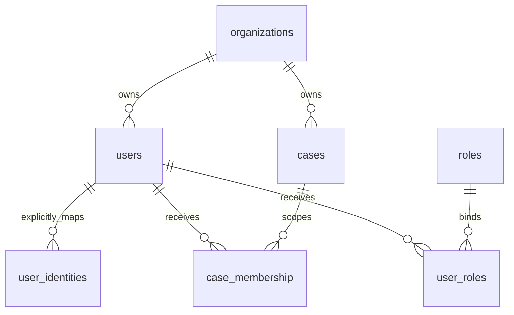

# T011/T012 身份、单位和案件数据库补充字典

2026-10-16；研发实现扩展。依据[设计](../03-development/t012-identity-relations-design.md)及[增量迁移0004](../../backend/business_migrations/0004_identity_relations.sql)。不包含真实账号、身份方或正式角色授权种子。

## 结构与来源

users.user_id为内部稳定用户标识。旧users.subject保留为兼容唯一标签，不能单独用于外部认证映射。一个单位拥有多个用户和案件；同单位用户可关联多个案件，一个案件可有多个成员。用户有角色不自动成为案件成员。跨单位协作没有默认授权，不通过重写用户或案件的org_id实现。

初始化基线[initial-schema.sql](initial-schema.sql)、[原数据字典](data-dictionary.md)、[table-catalog.json](table-catalog.json)仍描述62表825字段；它们保留原来源，不是应用0004后的完整结构。0001—0004后的实际结构为**63表840字段**，增量来源由本文及[机器扩展字典](identity-relations-catalog.json)记录。空库必须应用全部版本迁移；已有库只按摘要绑定的迁移升级。不能单独执行旧初始化SQL后宣称新身份结构存在。

## 新表 mt.user_identities

| 字段 | 类型与约束 | 精确定义 |
| --- | --- | --- |
| identity_id | uuid PRIMARY KEY | 内部生成的稳定映射编号，不是认证凭证。 |
| user_id | uuid NOT NULL | 和org_id共同引用users(user_id,org_id)，不从外部名称推导。 |
| org_id | uuid NOT NULL | 用户所属单位；复合外键阻止跨单位关联。 |
| issuer | text COLLATE C NOT NULL | 身份提供方精确标识；不改大小写、路径或末尾斜线，不自动发现提供方。不得空白、前后空格、控制字符，研发长度上限2048字符。 |
| subject | text COLLATE C NOT NULL | 提供方内部主体标识；与issuer联合终身唯一，不以姓名、邮箱或legacy subject自动合并，研发长度上限1024字符。上述长度不冒充正式认证协议要求。 |
| enabled | boolean NOT NULL DEFAULT false | 映射开关；登记本身不自动产生可登录身份。 |
| expires_at | timestamptz NULL | 有效期上界，当前时间必须严格小于此值；等于即失效，不擅定有效时长。 |
| revoked_at | timestamptz NULL | 非空即终态撤销，enabled必须false；不允许恢复或改绑复用。 |
| mapping_version | text NOT NULL | 登记所依据的映射规则版本引用，非空；不是JWT版本或完整权限策略版本。 |
| created_at | timestamptz NOT NULL DEFAULT now() | 首次登记时间，使用数据库时钟。 |
| updated_at | timestamptz NOT NULL DEFAULT now() | 最近变更时间，DAO条件更新时刷新。 |
| row_version | bigint NOT NULL DEFAULT 1 CHECK >0 | 本行并发版本，DAO以expected_version条件更新并加1；不代替完整审计或跨系统撤销同步。 |
| created_by | uuid NULL | 登记主体引用槽；系统/迁移可空，正式人事入口须补权威主体及审计。 |

精确来源为0004迁移中的同名列；机器字典逐字段记录类型、约束和源码。唯一约束包含已撤销行。身份键、user_id、org_id及identity_id不可普通UPDATE；DELETE/TRUNCATE拒绝，避免回收身份键给他人。

## 现有表增量

| 表/字段或约束 | 增量语义 |
| --- | --- |
| organizations.enabled boolean NOT NULL DEFAULT true | 单位运行开关；默认true保留原目录行为，不是单位已正式批准。停用后映射查询和案件访问拒绝，不改旧业务事实。 |
| users(user_id,org_id) UNIQUE | 为同单位复合外键提供稳定键；原主键及subject兼容唯一约束保留。 |
| case_membership(user_id,org_id)复合外键 | 用户与成员单位一致；结合已有案件/单位外键实现三者一致。旧脏关系使升级原子失败，不静默修正。 |
| user_roles.revoked_at timestamptz NULL | 角色绑定撤销时间，终态保留；提供存储和撤销DAO，不代表运行权限计算已接入。 |
| 稳定键保护 | 单位、用户、案件、成员、角色绑定和身份映射均不通过改键移动历史；调动、共享、再授权需后续生效设计。 |

## 访问边界

[IdentityDirectory](../../backend/business_app/identity/directory.py)提供真实SQL访问，事务由调用者管理。写入需要专用mt_directory_manager权限连接；mt_runtime不能管理目录。映射查询需要mt_identity_lookup，仅可执行受限函数，不能读取整张身份表。两组角色均NOLOGIN/NOSUPERUSER/NOBYPASSRLS，不提供默认账号或密码。

resolve每次重查映射、用户和单位状态；缺失、禁用、到期、撤销统一AUTHENTICATION_REQUIRED。该组件**不验证令牌、没有接入现有AuthorityProvider**；T013须先验证真实令牌再调用，不能以客户端自报主体作为登录依据。角色、案件、来源、用途和正式策略须独立核验。旧用户不自动生成外部映射。

## 升级与恢复

迁移入口business_migrations.runner.apply_migrations只接受显式mt_business_隔离数据库；升级前备份、排查跨单位成员。原0001—0003摘要不变，0004重放为空操作。升级失败整批事务回滚，保留原记录。

迁移后不通过丢表降级；停写并备份恢复到另一个独立目标，对账用户、单位、案件、成员、映射和迁移摘要后再切换连接。本批不切换共享服务，开发备份回归不等于正式身份平台灾备验收。

实际新建研发库、迁移时间、表/字段数、空账号检查及验证命令见[T012实测记录](../00-project/validation/t012-identity-relations-report.json)。连接信息只存Linux Git外私有运行目录。真实身份方、人员/单位/案件目录、正式角色冲突规则、撤销时限和人事审计继续待落实。
