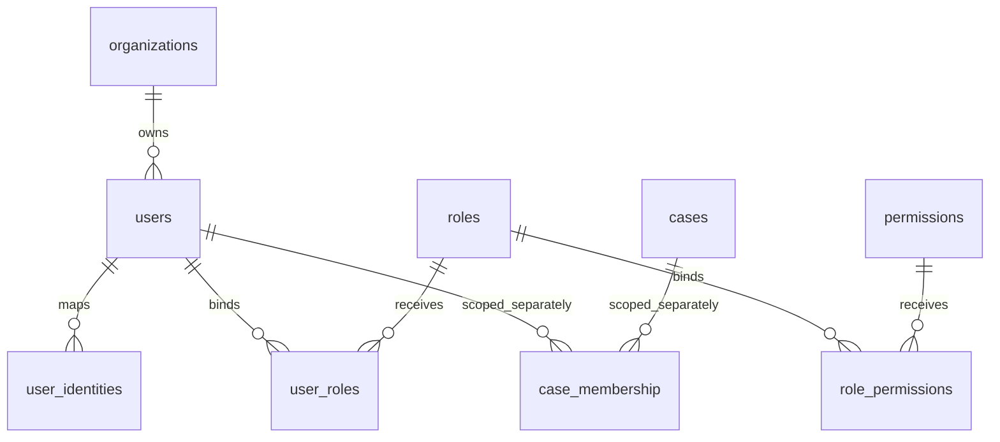

# T012 角色、权限与绑定数据库补充

2026-10-17；只增加内部数据库模型与管理DAO，不创建真实账号、正式六角色种子或HTTP管理入口。依据[源任务卡](../../tasks/platform/T012.md)、[T011候选模型](../08-security/access-control-model.md)及[0005迁移](../../backend/business_migrations/0005_role_catalog.sql)。

## 结构和来源

原初始化清单仍为62表825字段；[0004身份关系扩展](identity-relations.md)是63表840字段。0005新增下列3字段后为**63表843字段**；保留全部旧唯一约束、外键及0001—0004原字节。机器字段来源、列号和摘要见[扩展目录](role-catalog-extension.json)，不把旧初始化DDL冒充当前完整结构。

| 表/列 | 类型、空值、最终默认值 | 语义和升级差异 |
| --- | --- | --- |
| roles.enabled | boolean NOT NULL DEFAULT false | 角色目录停用开关。升级时原行填true保留旧行为，随后只将未来新行默认改为false；旧行的ID/code/row_version不变。 |
| permissions.enabled | boolean NOT NULL DEFAULT false | 权限目录停用开关，同样保留旧行、停用新行；不是正式审批或路由授权决定。 |
| role_permissions.revoked_at | timestamptz NULL，无默认值 | 非空即绑定终态撤销，不允许恢复为NULL或更换撤销时刻。撤销后原唯一组合仍占用，不能自动重建绑定。 |

角色和权限code继续终生唯一。0005补充非空、首尾ASCII空格/控制字符拒绝及1024字符研发存储保护；DAO同时使用既有valid_key校验，说明文本的DAO上限为4096字符。上述是研发输入保护，不是正式业务阈值。旧无效code会令整批升级失败，必须停留在0004并保留原数据，另行核查来源、审阅修复及后续迁移路径；当前运行器不能跳过失败的0005直接执行0006。不得由迁移静默改名或删行；成功升级后的已验证恢复路径是备份恢复到独立新目标。

## DAO与权限边界

复用[IdentityDirectory](../../backend/business_app/identity/directory.py)和既有DIRECTORY_*错误码。新增create_role、create_permission、bind_role、bind_permission、disable_role、disable_permission、revoke_permission、permission_bindings；原revoke_role继续适用。写入及绑定投影都要求mt_directory_manager，默认不创建任何登录账号或授给mt_runtime/mt_identity_lookup。三个目录表的管理写权单独授予既有管理组；没有新增DELETE/TRUNCATE权限。

停用/撤销以expected_version比较并递增row_version；角色/权限ID与code、绑定ID及两端不能普通UPDATE。用户角色与角色权限的原唯一组合包括撤销历史，因此重新授权需要另行明确的版本/历史设计，本轮没有放宽约束或恢复终态记录。管理连接仍属受信数据库管理边界，实际人事主体、审批、操作审计和发放流程不得由候选代码伪造。

permission_bindings只为管理连接核对目录：同时检查用户、单位、角色、权限开关，用户角色与角色权限撤销，以及严格大于statement_timestamp的角色到期时间。长事务每条语句重查，不缓存。它不验证外部令牌，不检查案件、用途、来源、数据分类和正式策略，不产出最终ALLOW，也没有接入/api/v1/auth/me或AuthorityProvider。现有业务OpenAPI、Schema与API字段投影保持原版本；这些内部列只通过本补充追溯，不伪造新的公共字段映射。

## 升级、失败与恢复

使用business_migrations.runner的摘要绑定、独立库名称检查和单事务升级。0004旧库只追加0005；重放为空操作。已有非法code或不安全的管理/查询组权限及继承关系会使0005原子失败，保留旧数据和4项迁移记录。共享PoC/生产数据库不执行本轮迁移。

成功升级后不以DROP列/删表回退。先停相关管理写入，备份原数据和迁移台账；恢复到全新、隔离目标，逐行对账organizations/users/roles/permissions/role_permissions/user_roles/user_identities以及迁移摘要，再验证开关、撤销和唯一冲突。恢复测试只证明同一隔离实例/相同角色体系下的数据完整性；更换所有者、异机角色映射、正式RPO/RTO和生产切换均另行验收。权限/身份原件及历史不能通过普通删除或TRUNCATE清空；数据库超级用户仍有DDL能力，这些触发器不是抵御管理员关闭触发器的安全边界。

## 验收与未决事项

实际测试、空研发库、源码摘要、CI与同步见[T012目录实测记录](../00-project/validation/t012-role-model-report.json)及[实施记录](../03-development/t012-role-model-implementation.md)。在报告生成和实测前不得据本文认定通过。

正式六角色对应的人事主体和授权矩阵、实际管理入口、统一认证与令牌失效、接口权限及完整操作审计分别按T013/T014/T017等任务落实；当前数据库模型不会替代这些功能。T012状态以任务卡所列技术验收和正式未决条件分别判断，不自动关闭后续任务。

## 技术依据

- [PostgreSQL16修改表定义](https://www.postgresql.org/docs/16/ddl-alter.html)：已有行的新增常量默认值与后续INSERT默认值分别设置；变更默认值不改旧行。检索日期2026-10-17。
- [PostgreSQL16触发器](https://www.postgresql.org/docs/16/sql-createtrigger.html)：DELETE/TRUNCATE语句级触发器用于拒绝普通删除，即使零行也执行；这不剥夺管理员DDL权限。
- [PostgreSQL16恢复工具](https://www.postgresql.org/docs/16/app-pgrestore.html)：本批将备份恢复到新建隔离目标并核对角色/所有者边界，不把no-owner当跨所有者策略自动适配。
