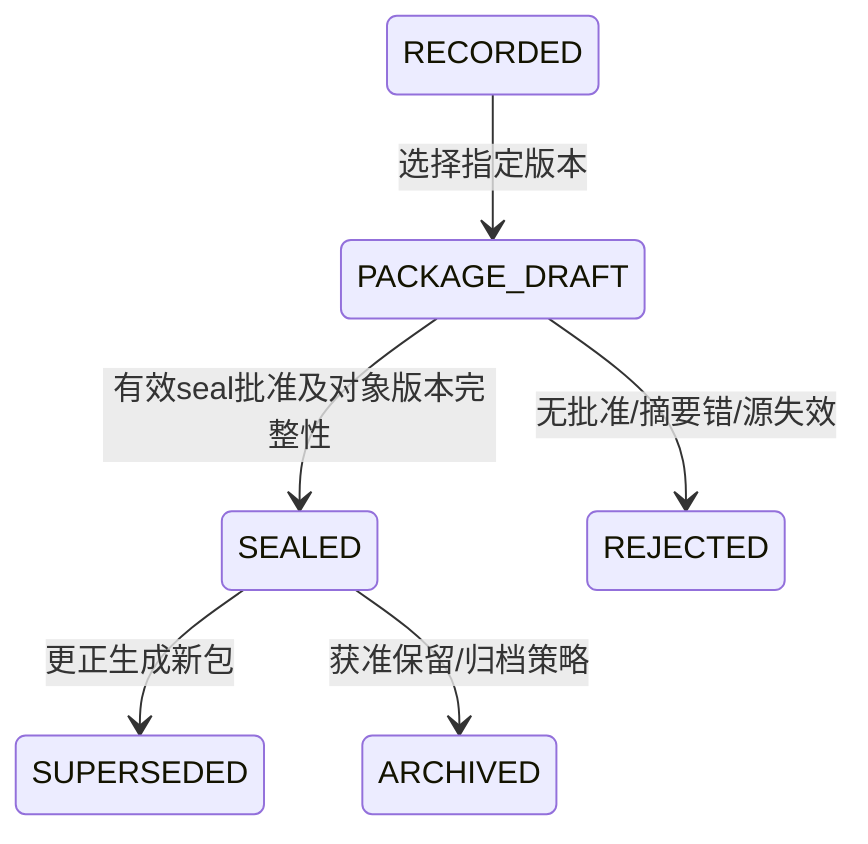

# evidence-state-machine

下列为源设计工程化候选，正式分支/批准仍待Q-24；非法转换返回TASK_STATE_CONFLICT，禁止覆盖终态历史。上传会话和分析任务分开。重算从新run_version QUEUED开始，旧运行留历史；progress只同一运行单调。

| 当前 | 下一 | 进入/触发条件 | 禁止/安全条件 |
| --- | --- | --- | --- |
| RECORDED | PACKAGE_DRAFT | 选择指定版本 | 证据事实不更新 |
| PACKAGE_DRAFT | SEALED | 有效seal批准及对象版本完整性 | 生成新包快照与清单 |
| SEALED | SUPERSEDED | 更正生成新包 | 原包保留，显示投影失效而非改原事实 |
| SEALED | ARCHIVED | 获准保留/归档策略 | 按version_id读取 |
| PACKAGE_DRAFT | REJECTED | 无批准/摘要错/源失效 | 禁止正式固化 |

每步记录actor、request_id、原因、对象/运行版本和审计；失败补偿有界重试，租约回收fencing拒旧结果。超时与优先级上限由获准配置给出；不编造时限。归档不允许普通修改证据与批准历史。
