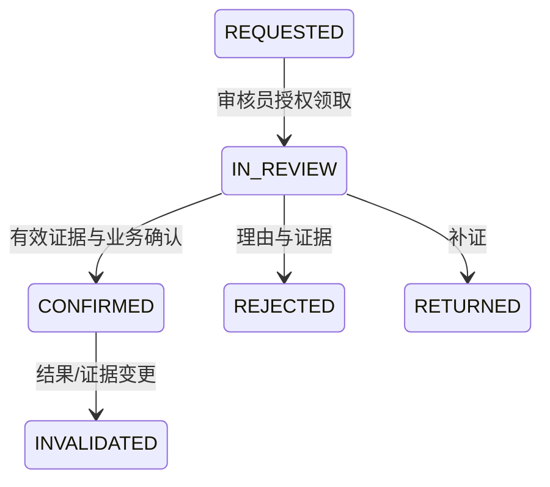

# review-state-machine

下列为源设计工程化候选，正式分支/批准仍待Q-24；非法转换返回TASK_STATE_CONFLICT，禁止覆盖终态历史。上传会话和分析任务分开。重算从新run_version QUEUED开始，旧运行留历史；progress只同一运行单调。

| 当前 | 下一 | 进入/触发条件 | 禁止/安全条件 |
| --- | --- | --- | --- |
| REQUESTED | IN_REVIEW | 审核员授权领取 | 职责与对象版本检查 |
| IN_REVIEW | CONFIRMED | 有效证据与业务确认 | 不自动批准训练/导出 |
| IN_REVIEW | REJECTED | 理由与证据 | 追加审核记录 |
| IN_REVIEW | RETURNED | 补证 | 保持版本 |
| CONFIRMED | INVALIDATED | 结果/证据变更 | 新版本另审，不覆盖原事实 |

每步记录actor、request_id、原因、对象/运行版本和审计；失败补偿有界重试，租约回收fencing拒旧结果。超时与优先级上限由获准配置给出；不编造时限。归档不允许普通修改证据与批准历史。
