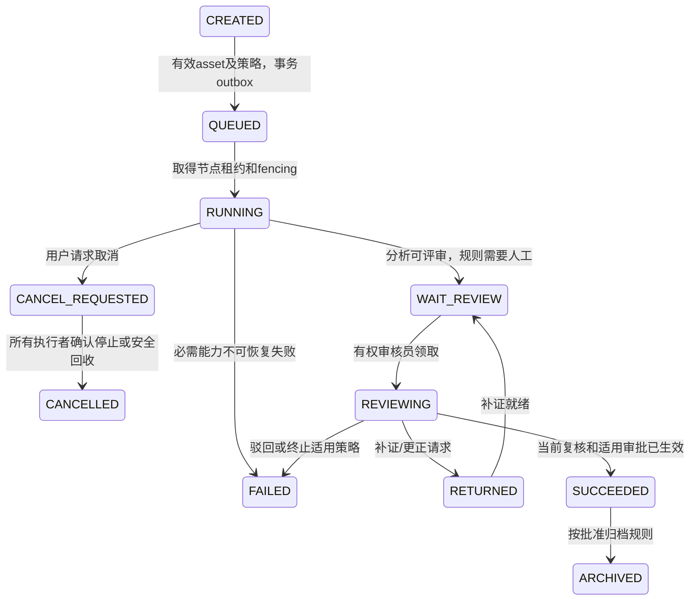

# task-state-machine

下列为源设计工程化候选，正式分支/批准仍待Q-24；非法转换返回TASK_STATE_CONFLICT，禁止覆盖终态历史。上传会话和分析任务分开。重算从新run_version QUEUED开始，旧运行留历史；progress只同一运行单调。

| 当前 | 下一 | 进入/触发条件 | 禁止/安全条件 |
| --- | --- | --- | --- |
| CREATED | QUEUED | 有效asset及策略，事务outbox | 调用主体有task.create |
| QUEUED | RUNNING | 取得节点租约和fencing | worker受信身份 |
| RUNNING | WAIT_REVIEW | 分析可评审，规则需要人工 | 缺失能力不冒充全完成 |
| RUNNING | FAILED | 必需能力不可恢复失败 | 错误可观察且保留历史 |
| RUNNING | CANCEL_REQUESTED | 用户请求取消 | 权限/版本有效，意图不等于停止 |
| CANCEL_REQUESTED | CANCELLED | 所有执行者确认停止或安全回收 | 旧token回报拒绝 |
| WAIT_REVIEW | REVIEWING | 有权审核员领取 | 当前结果版本一致 |
| REVIEWING | RETURNED | 补证/更正请求 | 理由和证据记录 |
| RETURNED | WAIT_REVIEW | 仅补证且输入/模型/策略未变；追加result_version | 原快照保留、旧批准不自动继承；returned_mode须有效 |
| REVIEWING | SUCCEEDED | 当前复核和适用审批已生效 | 完整资格单独判断 |
| REVIEWING | FAILED | 驳回或终止适用策略 | 正式状态规则待Q确认 |
| SUCCEEDED | ARCHIVED | 按批准归档规则 | 不得直接更改历史 |

每步记录actor、request_id、原因、对象/运行版本和审计；失败补偿有界重试，租约回收fencing拒旧结果。超时与优先级上限由获准配置给出；不编造时限。归档不允许普通修改证据与批准历史。

## RETURNED的可配置执行计划

[参数契约](../01-requirements/business-parameter-contract.md)定义补证同运行与重算新运行两条路径。涉及输入/模型/策略改变时创建新run_version，从QUEUED执行；原运行/结果留历史。未确定适用returned_mode时返回缺项原因，不自动迁移状态。离线returned_plan检查版本与批准继承；实际业务调度器仍待实现。
