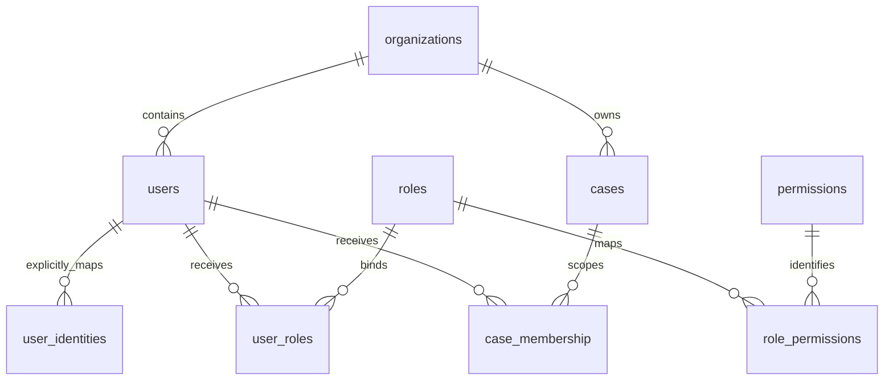

# T011 用户角色与数据范围模型

2026-10-16；状态为候选设计与合成评审验证，不是正式权限批准。对应[任务卡T011](../../tasks/platform/T011.md)、[机器模型](access-control-model.json)和[完整权限矩阵](permission-matrix.md#t011-全部权限码评审矩阵)。正式身份、业务策略、数据分级及真实负责人仍未落实。

本文原评审批次交付是可核对的模型关系、六类角色与全部权限码的评审矩阵，以及默认拒绝和越权场景的可执行设计验证。校验工具位于tools，不由业务应用导入，不实现登录、令牌签验或真实授权；T012至T015仍负责实际访问层、权威身份和权限接入。该评审批次未改变业务路由、OpenAPI和运行锁。2026-10-16后续身份数据补齐新增0004迁移及实际SQL访问层，见[数据库补充字典](../04-database/identity-relations.md)、[本批设计](../03-development/t012-identity-relations-design.md)及[T012实测记录](../00-project/validation/t012-identity-relations-report.json)；真实令牌验证和授权平台尚未接入。

## 输入与依赖核对

- 设计依据为《项目总体设计方案 技术修订版V1.4》2.4、5.4、8.5.2、9.1和T011源验收要求，阅读原文见[正文](../_converted/revision/项目总体设计方案_技术修订版V1.4.md)。六类角色来自原有职责，权限码映射是候选工程细化。
- T002提供已运行后端、配置校验和精确依赖锁。本批不需生产配置、真实账号或新解释器；13项已有配置与追踪检查在Linux py310通过，具体命令、时间和范围见[实施记录](../03-development/t011-access-model-implementation.md)。这不关闭T002整卡。
- T010提供需求、数据库、模型和架构决策变更模板。本轮按需求变更模板填写影响、验证、恢复与决定，引用其现有链接和状态；模板存在不等于正式审批。细节见实施记录。
- Q-05身份协议、Q-16安全等级、Q-20双人范围、Q-25受托方边界和Q-33实际人员继续待有效输入。见[权限评审包](../00-project/review-package/permission-review.md)。

## 实体关系与现有存储

| 概念 | 现有字段与约束 | 本轮边界及后续要求 |
| --- | --- | --- |
| 单位 | organizations.org_id；users.org_id；cases.org_id | 操作者、案件成员和资源必须属于相同获准单位；跨单位共享不从角色名推定，等待正式协议。 |
| 用户 | users.user_id、subject、enabled、row_version；enabled默认false | 旧subject仍是兼容唯一标签；外部映射使用新增user_identities的issuer/subject联合唯一键。不同身份方不自动合并，正式令牌验证和登记依据仍待接入。 |
| 角色 | roles.role_id、code、description、row_version | 本文六个代码是候选标识，不创建实际账号或写入真实角色目录。管理员没有业务内容通配权限。 |
| 功能权限 | permissions.permission_id、code及role_permissions | code绑定唯一OpenAPI的x-required-permission。角色职责只是评审依据，不产生正式允许值。 |
| 角色绑定 | user_roles.user_id、role_id、expires_at、row_version | 角色到期与变更必须重新核验；0004已增加revoked_at及终态保护，DAO支持条件撤销；权威撤销同步及完整策略版本仍待T013/T014接入。 |
| 案件范围 | case_membership.user_id、org_id、case_id、expires_at、revoked_at；案件及用户分别与org_id组成复合外键 | 功能权限和案件成员同时有效才可进入候选对象判定；SQL RLS是防御层，不认证HTTP身份。 |
| 对象与用途 | 由对应资源的org_id、case_id、object_id及其来源授权获得 | 对象、用途、来源撤销和结果版本按现有业务契约核验。评审夹具的对象授权不能直接落入现有角色绑定表。 |
| 数据分类与密级 | 正式级别、标签策略和对应持久字段尚未确定 | 机器模型保留null政策引用和空正式等级。本批没有新增classification列、法定级别、数字阈值或映射表。 |

上述字段从[既有版本迁移](../../backend/business_migrations/0001_business_baseline.sql)和[数据字典](../04-database/data-dictionary.md)核对。原评审批次不改变物理结构；后续0004身份扩展及其实际版本见补充字典；用户角色有效性、用途、分类和策略版本的实际接入若需要存储变更，应由后续任务同步SQL、字典、映射和迁移，不能把评审数据类当已实现的业务表。

## 六类角色与权限矩阵

系统管理员、数据管理员、算法管理员、业务审核员、案件核查人员和审计员全部保留。模型覆盖当前73个外部操作及41个唯一权限码，每个角色对每个权限码都有职责、限制或待定状态；多个操作共享一个权限码不等于操作遗漏。

职责表示来源描述与权限码的候选映射；例如模型管理与灰度归于算法管理员，生成报告归于案件核查人员，但生成不自动包含导出。限制只用于记录来源约束；例如审计员只读职责不支持任务创建、人工复核、证据固化、模型配置和系统配置。其他项均待正式决定。完整表由机器模型生成，不把职责或待定值转成ALLOW。

系统管理员的系统配置职责不能推导为全部业务策略职责。唯一契约PolicyCreate.kind包括风险标签、阈值、复核、保留和分析等类别，涉及T061、T068、T069、T102等业务任务；policy.manage和policy.read对系统管理员均保持待定，按策略类别取得实际职责依据后再修订矩阵。

健康检查、开发登录、本人身份、模型目录、索引和系统策略等端点的作用域不同于案件资源。本批评审器只演示机器模型明确列出的案件资源权限，其他权限返回REVIEW_SCOPE_UNSUPPORTED；它们仍保留在完整矩阵中，由相应后续任务定义本人、单位或平台范围，不能给任意case_id就放行。

## 候选判定流程

评审器只接受synthetic_review模式。它的输入全部为自建夹具，身份已核验等标志只描述测试前提；真实服务必须由受信权威适配器和数据库获得这些事实，不能读取HTTP客户端自报标志。production、development或未知模式一律拒绝，返回值runtime_authorization始终false。

案件资源的候选允许同时要求：

1. 时钟带时区；主体非空、身份已核验、账号启用；角色已知，绑定未撤销且未到期。
2. 权限码已知并属于本批案件资源评审范围；主体、资源和成员记录的单位一致。
3. 案件非空，成员绑定案件一致、未撤销且未到期；对象标识非空。
4. 用途、分类标签和策略版本均明确，来源角色限制不被覆盖。
5. 存在显式自建夹具授权，准确绑定用户、角色、权限、单位、案件、对象、用途、标签和同一策略版本，且处于有效期内、未撤销。

任一条件不满足返回DENY；全部满足也只返回CANDIDATE_ALLOW，表示该组自建前提下设计判定一致，不是业务服务已经授权。无显式授权、只有管理员角色、未知权限、过期或撤销、跨单位或案件、对象替换、用途改变、标签不足及版本失配都不能获得候选允许。

多个角色出现来源限制冲突时，评审器保守拒绝。本轮不确定正式角色兼容、职责分离或例外制度；后续决定可以版本化修订设计和测试，不能用未确认的多角色组合绕过限制。

## 数据分级和撤销的精确边界

fixture-label-a等名称仅为自建标签，不是现实密级。评审器检查显式标签包含关系，不比较中文、数字或字典序，也不推定高等级天然覆盖低等级。正式等级、用途、脱敏粒度和策略版本为空时继续待实际输入。本工具证明缺项和标签不匹配不会被候选允许，不能证明真实系统已经强制执行分级。

到期时刻采用now小于expires_at；相等即失效。角色、成员、对象授权和策略变化后应重新判定；本次测试覆盖旧授权重用被拒绝。权威撤销同步时限、缓存失效、跨进程身份和多主体合并仍需T012至T015按真实协议实现。

## 验证与剩余工作

入口：`python scripts/validate_access_control_model.py --run-tests`；专属测试为`python -m pytest tests/platform/test_t011.py -q`。校验器检查Schema、六角色覆盖、全部API操作和权限码、既有表及来源引用，并核对生成矩阵没有漂移。实际结果见[专属报告](../00-project/validation/t011-access-model-report.json)和[实施记录](../03-development/t011-access-model-implementation.md)。

正式角色授权矩阵、真实身份方与账号/单位/案件映射、数据分类策略、角色撤销与版本协议、实际责任人和有效复核均未落实。T011只登记本批设计和合成评审证据，不关闭整任务；T012至T015及生产验收不因本文产生而完成。
